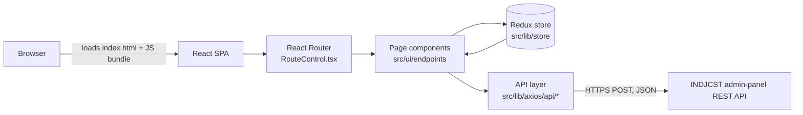

# INDJCST — Journal Website (React SPA)

Public website for **The Indian Journal of Computer Science and Technology (INDJCST, e-ISSN 2583-5300)**,
a peer-reviewed, open-access journal published by Fifth Dimension Research Publication.

Readers can browse the journal archive by year → volume → issue, open paper details (abstract,
references, citation, metrics, licensing, PDF and DOI), and explore conference proceedings, thesis
publications, blogs, tags, research topics, the editorial board, author guidelines and journal policies.

This repository is the **frontend only**. It is a React single-page application that gets all its
content from the journal's admin-panel REST API.

---

## Tech stack

| Area | Technology |
|---|---|
| UI library | React 19 (functional components + hooks) |
| Language | TypeScript 5 |
| Build tool | Vite 6 with `@vitejs/plugin-react-swc`, gzip + brotli pre-compression (`vite-plugin-compression`) |
| Routing | React Router 7 (`BrowserRouter`, nested routes, lazy-loaded pages) |
| State management | Redux Toolkit + React Redux (typed hooks, `createAsyncThunk`) |
| HTTP client | axios (shared instance in `src/lib/axios/axios-client.ts`) |
| Styling | Tailwind CSS 4 |
| UI extras | lucide-react, react-icons, react-toastify |
| Linting | ESLint 9 + typescript-eslint + react-hooks rules |
| SEO helpers | `MetaDataWrapper` (per-route title/description/canonical), JSON-LD in `index.html`, sitemap script |
| Hosting | SPA rewrite config for Vercel (`vercel.json`) |

---

## Architecture



**How a page loads**

1. The host serves `index.html` for every URL (`vercel.json` rewrites `/(.*)` to `/`).
2. `src/main.tsx` mounts React with `createRoot` and wraps the app in `StrictMode` → Redux `Provider` →
   `BrowserRouter` → `BaseLayout` → `Suspense` (loading fallback) → `ErrorBoundary`.
3. `src/App.tsx` renders the navbar, `RouteControl` (all routes), the footer, a scroll-to-top button and the toast container.
4. `src/RouteControl.tsx` lazy-loads the matching page with `React.lazy`, so each page is its own chunk.
5. The page reads URL params (`useParams`, `useSearchParams`) and calls the API layer in a `useEffect`.
6. Responses are reshaped by helpers in `src/lib/utils/`, stored in Redux slices or component state, and rendered.
7. `MetaDataWrapper` updates `document.title`, the meta description, keywords and the canonical link on each route change.

**Example: paper details page**

```
/archives/paper-details?paperid=<id>&papertitle=<slug>
  → ArticleDetails.tsx reads paperid (useSearchParams)
  → FetchActiveArticle() → POST /archivePaperNew
  → dispatch(setActivePaper(data))  (Redux ArchiveSlice)
  → tabs: Full Article · References · Citations · Metrics · Licensing
  → fetchPaperViewsThunk() → POST /papers/{id}/view (view counter)
```

---

## Project structure

```
├── index.html                  # HTML shell (#root), site-wide JSON-LD, chat & metrics widgets
├── vite.config.ts              # React (SWC), Tailwind, gzip/brotli compression
├── vercel.json                 # SPA rewrite: every route → index.html
├── public/                     # static images, robots.txt, sitemap.xml
└── src/
    ├── main.tsx                # app entry: providers, router, Suspense, ErrorBoundary
    ├── App.tsx                 # page shell: Navbar, routes, Footer, toasts
    ├── RouteControl.tsx        # all routes (lazy-loaded pages, nested routes)
    ├── hooks/                  # custom hooks (pagination, conference data)
    ├── lib/
    │   ├── axios/
    │   │   ├── axios-client.ts # shared axios instance (base URL + API key from env)
    │   │   └── api/            # one module per feature: archive, conference, thesis,
    │   │                       #   blog, editorial, topics, contact, latest updates, indexing
    │   ├── store/
    │   │   ├── store.ts        # configureStore + typed useAppDispatch / useAppSelector
    │   │   └── Features/       # Redux slices: archive, conference, thesis, blog, tag,
    │   │                       #   topics, editorial, pagination, loading
    │   ├── utils/              # response reshaping, metadata table, string helpers
    │   └── sitemap/            # Node script that builds public/sitemap.xml from the API
    ├── types/                  # TypeScript types for API data and UI props
    └── ui/
        ├── components/         # reusable UI: NavBar, Footer, cards, buttons, layouts,
        │                       #   Loading, ErrorBoundary, MetaDataWrapper, SharePopup
        ├── endpoints/          # page components, grouped by section:
        │   ├── home/  archive/  current-issue/  conference/  Thesis/
        │   ├── blog/  Editorial/  about/  for-authors/  contact-us/
        │   └── external/  footer/  indexing&abstract/
        └── other/              # small helpers (ScrollToTop, titles)
```

---

## Main routes

| Section | Routes |
|---|---|
| Home | `/` |
| Archives | `/archives`, `/archives/paperlist?year=&volume=&issue=`, `/archives/paper-details?paperid=` |
| Current issue | `/current-issue`, `/current-issue/paperlist`, `/current-issue/paper-details` |
| Conference | `/conference`, `/conference/paperlist`, `/conference/paper-details`, `/conference-procedings` |
| Thesis | `/publications`, `/thesis`, `/thesis/paperlist`, `/thesis/paper-details` |
| Blog | `/blogs`, `/blogs/:slug`, `/tag`, `/tag/:slug` |
| About | `/aim-and-scope`, `/editorial-board`, `/editorial-board/:slug`, `/indexing-and-abstracting`, `/ethics`, `/peer-review-policy`, `/publication-ethics-policy`, `/cross-mark-policy`, `/ai-policies`, `/impact-Factor`, `/FAQs`, `/journal-particulars` |
| For authors | `/call-for-papers`, `/instruction-for-author`, `/journal-publishing-process`, `/topics`, `/topics/:slug`, `/paper-status`, `/article-processing-charges`, `/guidance-for-ems`, `/downloads` |
| Other | `/contact-us`, `/privacy-policy`, `/terms-and-conditions`, `/refund-policy`, SEO landing pages, `*` (404) |

---

## Key features

- Archive browsing by year, volume and issue, with search and pagination
- Paper detail page with tabs, PDF download, DOI/Crossmark link, related articles and view counts
- Conference and thesis listings that follow the same pattern as the archive
- Blog and tag pages, research topics, and editorial board profiles
- Contact form with client-side validation and toast notifications
- Route-level code splitting (`React.lazy` + `Suspense`) and an error boundary
- Per-route page titles, meta descriptions and canonical links, plus a generated `sitemap.xml`
- PlumX / Dimensions metrics badges and live-chat widget

---

## Getting started

### Prerequisites
- Node.js 18+ and npm
- Access to the INDJCST API (base URL and API key)

### Setup
```bash
git clone https://github.com/Info-God/Prod-INDJCST.git
cd Prod-INDJCST
npm install
cp .example.env .env      # then fill in the values
npm run dev               # starts Vite dev server (--host)
```

### Environment variables
Create `.env` from `.example.env`. **Never commit `.env`**; it is already in `.gitignore`.

| Variable | Purpose |
|---|---|
| `VITE_API_BASE_URL` | Base URL of the REST API used by the axios client |
| `VITE_API_KEY` | Key sent in the `Authorization` header |
| `VITE_API_HOST_URL` | Host URL of the API/admin panel (used for assets) |

> ⚠️ Vite compiles every `VITE_*` variable into the public JavaScript bundle, so anyone visiting the
> site can read them. Don't put real secrets in these variables. Use a backend proxy or public
> read-only endpoints for anything sensitive.

### Scripts
| Command | What it does |
|---|---|
| `npm run dev` | Start the dev server with hot reload |
| `npm run build` | Type-check (`tsc -b`) and build to `dist/` |
| `npm run preview` | Preview the production build locally |
| `npm run lint` | Run ESLint |
| `npm run sitemap` | Generate `public/sitemap.xml` from the API |

---

## Deployment

`npm run build` creates static files in `dist/` (with `.gz` and `.br` copies). Deploy them to any
static host and make sure every route falls back to `index.html`. `vercel.json` already does this
for Vercel. Set the `VITE_*` variables in the host's environment **before** building.

---

## Known limitations

- **Client-side rendering:** the server sends an empty `#root` and the content and page metadata appear
  only after JavaScript runs. That limits SEO for crawlers that don't execute JS, and scholarly
  citation tags (`citation_*`) aren't emitted. Server-side rendering or prerendering would address this.
- Unknown URLs return HTTP 200 and render the 404 page on the client (a soft 404).
- Paper URLs use query parameters (`?paperid=`) rather than path-based slugs.

---

## License

Proprietary. © INDJCST / Fifth Dimension Research Publication. All rights reserved.
